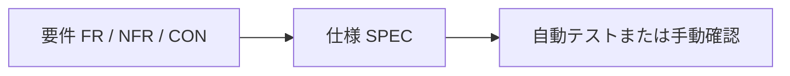

# AGENTS.md — 株リンク (kabu-tantan) 開発ガイド

> AI エージェント（Claude Code など）が最初に読むファイル。**AI が覚えておくべきことはここに書く**
> （末尾の「[AI エージェント向けの記録](#ai-エージェント向けの記録)」）。`CLAUDE.md` は置かない。

## プロジェクト概要

日本の証券会社サイト（楽天証券・SBI証券）および TradingView 上に、外部の株式情報サイトへのリンクメニューを追加する Chrome 拡張機能。

- **拡張機能名:** 株リンク
- **Manifest:** v3
- **バージョン:** `src/manifest.json` の `version`（`package.json` / `package-lock.json` と一致させる。`npm run validate` が検証する）
- **ライセンス:** MIT

## クイックスタート

```bash
npm install
npx playwright install chromium   # 初回のみ

npm run lint          # ESLint (JS)
npm run lint:css      # Stylelint (CSS)
npm run lint:all      # 両方
npm run fix           # 自動修正
npm run validate      # manifest.json の構造・参照先・バージョン整合を検証
npm test              # Playwright による UI テスト
npm run check         # lint:all + validate + test。通ると作業ツリーを記録する
npm run check:docs    # 文書の検査だけ（lint:md + テストカタログの陳腐化検査）。文書だけの変更で使う
npm run package       # dist/kabu-tantan-<version>.zip を作成
npm run docs:tests    # docs/TEST-CATALOG.md を再生成
npm run approve       # レビュー承認を記録する（コミットに必須）
```

> `npm run check` は lint + validate + テスト + **テストカタログの陳腐化検査**を行う。
> 通ると作業ツリーを `.claude/check-passed.json` に記録し、同じ作業ツリーなら `npm run approve` は流し直さない
> （[docs/notes/workflow.md](docs/notes/workflow.md)「全件のチェックを同じ作業ツリーで2回流さない」）。
>
> **コミットは、テスト全件が通り（文書だけの変更は文書の検査が通り）、かつ reviewer のレビューが通るまでできない。**
> `.claude/hooks/commit-gate.sh` が機械的にブロックする。詳細は [docs/notes/workflow.md](docs/notes/workflow.md)。

### Chrome への読み込み

1. `chrome://extensions/` を開く
2. 「デベロッパーモード」を有効にする
3. 「パッケージ化されていない拡張機能を読み込む」から `src/` を指定

> ビルドステップは無い。`src/` がそのまま拡張機能として動作する。

## アーキテクチャ

```text
src/                        ← このディレクトリがそのまま拡張機能
├── manifest.json           # マニフェスト (v3)
├── service_worker.js       # バックグラウンド Service Worker
├── urls.js                 # 外部リンク定義・URL ユーティリティ (共有)
├── linkMenu.js             # ドロップダウンメニュー生成 (共有)
├── style.css               # 楽天・SBI 用スタイル
├── rakuten-cs.js           # 楽天証券
├── rakuten-scr-cs.js       # 楽天スーパースクリーナー
├── sbi-cs.js               # SBI証券
├── sbi-scr-cs.js           # SBI銘柄スクリーニング
├── tradingview-cs.js       # TradingView
├── tradingview-cs.css      # TradingView 用スタイル
├── options.html/js/css     # オプションページ
├── notice.html/js/css      # 右クリックの項目で開けないときに理由を知らせる小窓
├── _locales/ja/            # 日本語ローカライズ
├── images/                 # アイコン画像
└── third-party/            # 同梱ライブラリ (編集しない。docs/notes/architecture.md 参照)

scripts/                    # 開発用 Node スクリプト (validate / package / test-catalog)
tests/                      # Playwright テスト
docs/
├── tasks.md                # 入口: 残りのタスク (AI の分も利用者の分も)
├── requirements.md         # 入口: 何を作るか → notes/requirements/
├── design.md               # 入口: どう作るか → notes/architecture.md・notes/specs/・notes/adr/
├── verification.md         # 入口: 確かめ方と結果 → notes/testing.md・notes/manual-checklist.md ほか
├── notes/                  # 現在の資料（英小文字とハイフン。話題ごとのフォルダは1段まで）
│   ├── architecture.md     # 実装構造・同梱ライブラリの更新手順
│   ├── testing.md          # テスト方針・3層の切り分け
│   ├── manual-checklist.md # 手動確認と結果
│   ├── workflow.md         # 開発フロー・エージェント・コミットゲート
│   ├── requirements/       # 要件 (FR / NFR / CON)。index.md が案内する
│   ├── specs/              # 仕様 (SPEC)。index.md が実装との対応を案内する
│   └── adr/                # 設計判断 (ADR)。index.md が案内する
├── TEST-CATALOG.md         # テスト一覧 (自動生成)
├── SELECTOR-CHECK.md       # 実サイトのセレクタ検証結果 (check:selectors の生成物)
├── images/                 # 固定した既存スクリーンショット（移動しない）
└── zenn/                   # 固定した2026年8月の作業ログ（移動しない）

.claude/
├── agents/                 # 要件 / 設計 / 実装 / レビュー / 調整のエージェント定義
├── hooks/commit-gate.sh    # コミットゲート (PreToolUse)
└── settings.json           # フック設定
```

| レイヤー | ファイル | 役割 |
| --- | --- | --- |
| Service Worker | `service_worker.js` | コンテキストメニュー管理、メッセージハブ、タブ操作 |
| 共有モジュール | `urls.js`, `linkMenu.js` | URL 定義・生成、メニュー DOM 生成 |
| Content Script | `*-cs.js` | 各サイトへのメニュー注入 |
| オプション | `options.*` | ユーザー設定 UI |

詳細は [docs/notes/architecture.md](docs/notes/architecture.md)。

### ドキュメントの役割分担

| ディレクトリ | 書くもの | 担当エージェント |
| --- | --- | --- |
| `docs/notes/requirements/` | **満たすべきこと**（FR / NFR / CON） | analyst |
| `docs/notes/specs/` | **今そうなっていること**（SPEC-xx）。実装と1対1 | architect |
| `src/`, `tests/` | 実装 | developer |
| — | レビュー（書き換えなし） | reviewer |

どこを開けばよいかは、`docs/` 直下の入口の4ファイル（[tasks.md](docs/tasks.md)・[requirements.md](docs/requirements.md)・[design.md](docs/design.md)・[verification.md](docs/verification.md)）が案内する。
入口は上の表の文書を案内し、残りのタスクは `docs/tasks.md`、検証の結果と証拠の案内は `docs/verification.md` に置く。
現在の資料は `docs/notes/` に置く（2026-10-17 に旧配置から移行）。生成物2ファイル・既存画像・固定した過去の作業ログは動かさず、入口から案内する。
**仕様書は「あるべき姿」ではなく「実際にそうなっているもの」を書く。**

### このプロジェクトの文書の入口

- 要件の状態・優先度・更新履歴: [docs/notes/requirements/index.md](docs/notes/requirements/index.md)。背景・目的は同じフォルダの `background.md`
- 実装と1対1の仕様: [docs/notes/specs/index.md](docs/notes/specs/index.md)。領域は `SPEC-MF`（manifest）、`SPEC-EL`（外部リンク）、`SPEC-TC`（銘柄判定）、`SPEC-ST`（保存）、`SPEC-SW`（Service Worker）、`SPEC-MSG`（通信）、`SPEC-CS`（注入）、`SPEC-OP`（オプション）、`SPEC-NT`（小窓）、`SPEC-SC`（実サイト検証）
- 選択肢を比較して決めた記録: [docs/notes/adr/index.md](docs/notes/adr/index.md)
- 実装構造・同梱ライブラリの更新: [docs/notes/architecture.md](docs/notes/architecture.md)
- テストの切り分け・実行: [docs/notes/testing.md](docs/notes/testing.md)。実際に手で見る項目と結果は [docs/notes/manual-checklist.md](docs/notes/manual-checklist.md)
- フロー・担当の権限・コミットゲート: [docs/notes/workflow.md](docs/notes/workflow.md)

`docs/SELECTOR-CHECK.md` は毎回上書きされる生成物。数値や判定を引用するときは収録コミットを添える（例: `git show e0d3c5e:docs/SELECTOR-CHECK.md`）。
規約は SPEC-SC-13、実行ごとの一覧は FR-12「結果ファイルの出典」表。現在の結果へのリンクだけでは次回実行後に出所を追えない。

### ID 採番規則

| 接頭辞 | このプロジェクトでの対象 | 例 |
| --- | --- | --- |
| `FR-` | 機能要件 | `FR-01` |
| `NFR-` | 非機能要件 | `NFR-01` |
| `CON-` | 制約条件 | `CON-01` |
| `SPEC-<領域>-` | 現在の仕様 | `SPEC-CS-03` |
| `ADR-` | 設計判断 | `ADR-0001` |

既存 ID は再利用しない。廃止する場合は項目を残して「廃止」と明記し、欠番にする。

### 追跡関係



仕様には満たす要件と確かめ方を書く。要件に紐づかない仕様は要件の漏れを疑う。実装との食い違いは放置しない。

### エージェント

`.claude/agents/` に役割を分けて定義してある。**サブエージェントは役割をまたぐ変更をしない。**

| エージェント | 役割 | 書き換えてよい場所 |
| --- | --- | --- |
| `lead` | 全体調整。工程を回す | なし |
| `analyst` | 利用者と対話して要件を決める | `docs/notes/requirements/` |
| `architect` | 要件から設計・仕様を起こす | `docs/notes/requirements/`, `docs/notes/specs/`, `docs/notes/architecture.md`, `docs/notes/adr/` |
| `developer` | 仕様に従って実装する | `src/`, `tests/`, `scripts/`, ルート設定 |
| `reviewer` | 実装と文書を突き合わせて検証する | **なし（読み取り専用）** |

`AGENTS.md`・`docs/` 直下の入口の4ファイル・`docs/notes/workflow.md`・`docs/notes/testing.md`・`docs/notes/manual-checklist.md`・`.claude/` は、どの担当の書き換え範囲にも入れない。
書くのはメインセッション（利用者と直接やり取りしている AI）だけ（`AGENTS.md` は下の「[AI エージェント向けの記録](#ai-エージェント向けの記録)」）。

担当を指定せずに起動したメインセッションは、この表の書き換え範囲に縛られない（`src/third-party/` を編集しないなど、ほかの規則には従う）。
`claude --agent <担当>` で起動したときは、その担当の定義（書き換えてよい場所を含む）に従う。
サブエージェントに渡すのは、独立した確認（レビュー）・並行できる作業・利用者が `claude --agent` で工程を回すと決めたときだけ
（[docs/notes/workflow.md](docs/notes/workflow.md)「サブエージェントに渡す基準」）。

フロー・モデル選定・コミットゲートは [docs/notes/workflow.md](docs/notes/workflow.md)。

### データフロー

1. オプションページで遷移先を設定 → `chrome.storage.sync` に保存
2. Service Worker が `storage.onChanged` で検知 → コンテキストメニュー再構築
3. Content Script がページ読み込み時に `chrome.storage.sync` から設定取得 → メニュー生成

### メッセージ通信

`chrome.runtime.sendMessage` / `onMessage` で通信する。

| type | 用途 |
| --- | --- |
| `rakuten-sec:info` | 楽天証券の個別銘柄 URL を組み立てられるか（ログイン済みタブがあるか）を返す |
| `rakuten-sec:open` | Service Worker が URL を組み立てて新しいタブで開く |
| `naito-sec:info` | 内藤証券の個別銘柄 URL を組み立てられるかを返す |
| `naito-sec:open` | Service Worker が URL を組み立てて新しいタブで開く |
| `open-url` | 指定 URL を新しいタブで開く |

> 証券会社の URL（楽天証券の `BV_SessionID` を含む）は **Service Worker の外へ出さない**。
> 応答は `{ available: boolean }` だけで、Content Script にも注入先ページの DOM にも URL を渡さない（SPEC-MSG-06 / ADR-0016）。

## ⚠️ 他社サイトに注入するという前提

**このコードは自分たちが作っていないサイトの DOM を書き換える。** これが設計上もっとも重要な制約。

### CSS を消すときの鉄則

セレクタには**対象サイト側で定義済みのクラス**が混ざる（例: TradingView の `theme-dark`、
`chart-widget__top--themed-light`、`apply-common-tooltip`、`button-hw_3o_pb`）。
リポジトリを grep して「使われていない」ように見えても、サイト側にあるものは消してはいけない。

削除前に必ずこの順で確認する:

1. **`src/manifest.json` の `content_scripts` を見る。** どの CSS がどの `matches` に注入されるかが分かる。
   注入先サイトと無関係な規則は確実に死にコード。
2. **接頭辞で判定する。** `ktt-tv-` / `x-kabu-` は拡張が自分で付ける独自クラス。
   `src/*.js` に付与箇所が無ければ死んでいる。接頭辞が無いものはサイト側の可能性が高いので残す。
3. **`git log -S'<クラス名>' -- src/`** で、付与していた JS がいつ消えたかを追う。
4. サイト側クラスと独自クラスを**同一要素で**組み合わせた規則は、独自クラス側が死んでいれば規則ごと死んでいる。

同じ理由で Stylelint の `selector-class-pattern` は無効にしてある（サイト側のハッシュ付きクラス名に合わせるため）。

### セレクタは壊れる前提で書く

`menuSelectors` はサイト側の DOM 構造に強く依存する。サイト改修で無言のうちに効かなくなるため、
動かなくなった報告があればまず対象サイトの実 DOM を確認する。

## コーディング規約

### 言語・スタイル

- **JavaScript (ES2021+)**、TypeScript は使わない
- **インデント:** スペース 2（`.editorconfig` 参照）／**改行:** LF ／**文字コード:** UTF-8
- **セミコロンなし・シングルクォート**（neostandard 準拠）

### Lint

- **JS:** ESLint 9 + [neostandard](https://github.com/neostandard/neostandard)（flat config: `eslint.config.mjs`）
- **CSS:** Stylelint 17 + stylelint-config-standard + **stylelint-config-recess-order**（`stylelint.config.mjs`）
- `src/third-party/` は両方の対象外
- **プロパティの並び順も Stylelint が見る。** 旧 `.csscomb.json` は廃止し
  `stylelint-config-recess-order` に統合した。`npm run fix` で自動整列される

> ESLint 10 系にはまだ上げていない。neostandard の ESLint 10 対応が prerelease
> (`0.14.0-next`) のみのため、安定版が出たら追随する。

### 命名規則

| 対象 | 規則 | 例 |
| --- | --- | --- |
| 関数（非同期） | `camelCase` + `Async` | `getEnableLinkKeysAsync()` |
| 定数 | `UPPER_SNAKE_CASE` または `camelCase` | `menuSelectors` |
| jQuery 要素 | `$` プレフィックス | `$menu` |
| CSS クラス（楽天・SBI） | `x-kabu-` プレフィックス | `x-kabu-body` |
| CSS クラス（TradingView） | `ktt-tv-` プレフィックス | `ktt-tv-kabuLinkMenu` |

### Content Script の共通パターン

```javascript
$(() => {
  setTimeout(attachAsync, 500)   // サイト側の描画完了を待つ
})

async function attachAsync () {
  const keys = await getEnableLinkKeysAsync()
  if (keys.length === 0) return

  menuSelectors.forEach((menuSelector) => {
    $(menuSelector.selector).each((_, element) => attachMenu(element, keys))
  })
}
```

- 動的コンテンツには `MutationObserver` を使う（`rakuten-scr-cs.js` / `sbi-scr-cs.js` 参照）
- 外部リンクには必ず `target="_blank" rel="noopener noreferrer"` を付ける

### 外部リンクの追加方法

1. `src/urls.js` の `externalUrls` にエントリを追加

   ```javascript
   {
     key: 'site-name',                  // 一意なキー（storage の識別子になるので後から変えない）
     title: 'サイト名',
     url0: 'https://...',               // トップページ（オプション画面のリンク先）
     url1: 'https://.../${code}',       // 国内株
     url2: 'https://.../${exchange}/${code}',  // 米国株・取引所コードあり（任意）
     url3: 'https://.../${code}'        // 米国株・取引所コードなし（任意）
   }
   ```

2. `npm test` を実行する（`externalUrls` の整合性テストが走る）
3. `src/manifest.json` と `package.json` の `version` を更新し、`npm install --package-lock-only` で lock を同期する

> `key` は `chrome.storage.sync` に保存される識別子。変更すると既存ユーザーの設定が失われる。

### バージョニング

セマンティックバージョニング。`src/manifest.json` と `package.json` の**両方**を更新し、
`npm install --package-lock-only` で `package-lock.json` を同期する
（`npm run validate` が3者の不一致を検出する。SPEC-MF-09）。

> `package.json` を手で書き換えるだけだと lock が追随しない。1.10.0〜1.20.1 の間、lock の version は 1.10.0 のまま止まっていた。

## テスト

Playwright で拡張機能を実際に Chromium へロードして検証する。詳細は [docs/notes/testing.md](docs/notes/testing.md)。

| ファイル | 対象 |
| --- | --- |
| `tests/service-worker.spec.mjs` | `getTickerCode` / `compareVersion` / `makeUrl` / `externalUrls` の整合性 |
| `tests/options.spec.mjs` | オプションページの表示・保存・並び替え・外部リクエスト有無 |
| `tests/content-script.spec.mjs` | 楽天・SBI へのメニュー注入（フィクスチャ HTML を実オリジンで差し替え） |
| `tests/tradingview.spec.mjs` | TradingView で拡張が作った DOM（ウォッチリストの行の起点（国内株・米国株・対象外の行・行の差し替え後・チャートの非退行）・項目の集合と順序（入れ子とボタン・設定順）・入れ子の開閉と位置（猶予・Esc・外クリック・右端・高さ・キー・0件）・ボタンのメニューの閉じ方と遷移・右クリックで足す行と二重追加の防止・入れ子メニューのクリック範囲・縦位置補正・証券会社の項目が URL を DOM に出さないこと・未知キーの読み飛ばし・「株Link」ボタンの表示と隠れ方・遅れて出たボタンの追随・項目0件のとき・証券会社のタブの有無・半自動検証が測る入れ子の隙間と実際の位置の一致）と、セレクタからフィクスチャを組み立てる規則。サイト側の実 DOM は見ない（CON-08） |
| `tests/disconnected.spec.mjs` | 拡張機能を再読み込みした後に残った古いタブ（切断状態）。TradingView・スクリーナー・楽天証券・SBI証券で、注入しない・例外を出さない・タブを再読み込みすれば戻ること（NFR-14 / 手動確認だった G 節） |
| `tests/notice.spec.mjs` | 右クリックの項目で開けないときの小窓（文言・設定順の並び・選択文字列を出さないこと・HTML として解釈しないこと・閉じ方・外部リクエストゼロ・大きさへの収まり） |
| `tests/selector-defs.spec.mjs` | `menuSelectors` の定義・`check:selectors` の中断処理・手がかりの消毒と書式・TradingView のウォッチリストの行の数え方と入れ子の隙間の測り方 |
| `tests/check-record.spec.mjs` | コミットゲート: `npm run check` が通った作業ツリーの記録と、`npm run approve` がそれを使い回す条件、作業ツリーのハッシュ（日本語の名前の未追跡ファイル・名前の変更）、文書だけの変更を文書の検査だけで承認する条件、チェックの途中で作業ツリーや HEAD が変わったら記録・承認しないこと（一時の git リポジトリで。ブラウザは起動しない） |
| `tests/commit-gate.spec.mjs` | コミットゲートのフック: コミットされる中身（index）が承認した中身と同じときだけ通すこと（一部だけのステージ・ステージしてから作業ツリーを戻した中身・パスの指定・`-a` と未追跡のファイル・前に置くコマンド（`set` と `GIT_` の代入を含む）・シェル経由・場所の変更・ヒアドキュメント・引用符とリダイレクト）、commit 以外でコミットを作るコマンド（merge など・`--skip`・`git pull`）を止めること、`--continue` の中身と残りの手順（一時の git リポジトリで。ブラウザは起動しない） |

テストの一覧は [docs/TEST-CATALOG.md](docs/TEST-CATALOG.md)（`npm run docs:tests` で自動生成）。
**テストを増減したらこれを再生成すること。**

**TradingView の自動テストは、拡張が自分で作った DOM の振る舞いだけを見る**
（`tests/tradingview.spec.mjs`）。**緑でも実サイトが壊れていない根拠にはならない**（CON-08）。
サイト側の DOM・見た目・挙動は `npm run check:selectors` と
[docs/notes/manual-checklist.md](docs/notes/manual-checklist.md) の A セクションが見る。
変更時は同チェックリストに従って利用者に確認を依頼する。

検証の切り分け（自動 / 半自動 / 手動）は [docs/notes/testing.md](docs/notes/testing.md) を参照。

## 注意事項

- **ビルドシステムなし:** ES モジュール (`import`/`export`) は使えない。
  スクリプト間の共有は `manifest.json` の `js` 配列の読み込み順で制御する
  （`npm run validate` が読み込み順を検証する）
- **jQuery 依存:** Content Script では `$` がグローバルで利用可能
- **外部リソースを実行時に取得しない:** Chrome ウェブストアの審査とプライバシーの観点から、
  フォント・アイコン・画像はすべて `src/` に同梱する
  （`tests/options.spec.mjs` に外部リクエストゼロを保証する回帰テストがある）
- **`src/third-party/` は編集しない:** 更新手順は [docs/notes/architecture.md](docs/notes/architecture.md) 参照

## AI エージェント向けの記録

**この拡張機能について AI が覚えておくべきことは、このファイルに書く。** 個人用のメモリ（Claude Code の auto memory など）には置かない。
`CLAUDE.md` は置かない（2026-10-11 利用者判断）。Claude Code は v2.1.277 以降、作業ディレクトリとその上に `CLAUDE.md`
（`.claude/CLAUDE.md`・`CLAUDE.local.md` を含む）が無ければ本ファイルを読む。利用者の `~/.claude/CLAUDE.md` はこの判定に数えないので、
あっても本ファイルは読まれる（[公式ドキュメント](https://code.claude.com/docs/en/memory)。2026-10-12 に確認）。
サブエージェントも、定義に `omitClaudeMd` が無ければ `~/.claude/CLAUDE.md` と本ファイルを読み込む
（[公式ドキュメント](https://code.claude.com/docs/en/sub-agents)「What loads at startup」。2026-10-12 に確認）。

**書くのはメインセッション**（利用者と直接やり取りしている AI）。サブエージェント（`.claude/agents/`）は書かず、
記録すべきことに気づいたら報告に書いてメインセッションに渡す。本ファイルの変更もコミットゲート（reviewer → `npm run approve`）を通す。

| 書く | 書かない |
| --- | --- |
| この拡張機能で繰り返し効く規則・手順、実行環境の癖、利用者との進め方の取り決め | 進行中の状態（どの版を申請したか、残り・次の一手・未決の質問など）、個人情報、コードや git 履歴から読み取れること |

進行中の状態は、git log・docs と、利用者の Obsidian のプロジェクトノートに残す。
残りのタスクは [docs/tasks.md](docs/tasks.md) に置く。増えたら足し、済んだら消して、その作業のコミットに含める（公開リポジトリなので、私的なことは書かない）。
本人の分は、今要るときだけ頼む（一覧にあることを理由に、報告で先に予告しない）。
Chrome 拡張機能に共通する取り決めとノウハウは、利用者の共通ルール `~/.claude/rules/chrome-extensions.md` に書く。
**このリポジトリで作業するときは、着手前にそのファイルと `~/.claude/rules/testing.md` を読む**
（自動の読み込みは対象のファイルを開いたときにしか起きず、このプロジェクトの Content Script（`*-cs.js`）は対象のパターンに当たらない）。
利用者への依頼は必要になった時点でだけ出すこと・手動確認の補助ページの作り方・自動テストを基本にすること・リリースの分担は、
そこにある（2026-08-23〜10-12 にこのリポジトリで利用者と決めたもの。2026-10-12 にここから移した）。
この2つはこのリポジトリの持ち主の環境での決まりで、ほかの人の環境では従わなくてよい。ここには、この拡張機能に固有のことだけを書く。

### 図は Mermaid で書く

このリポジトリの文書の書式なので、誰が書くときも従う。罫線のアスキーアートは日本語が混ざると崩れるので使わない（ディレクトリツリーは例外）。

### 手動確認の補助ページ（このプロジェクトでの実測）

補助ページの作り方は共通ルールにある。このプロジェクトでは、ページを消す前に結果を `docs/notes/manual-checklist.md` に記録する。

- `file://` で開いたページでも、株リンクの右クリックメニューは出て、押すとタブや小窓も開く（2026-10-12 の D-1 で確かめた。
  `chrome://extensions` の「ファイルの URL へのアクセスを許可する」がオンだったかオフだったかは記録していない）

### 自動でテストできるものは、自動でテストする

**テストは自動化を基本にする。** 利用者に手動確認を頼むのは、自動化できないと確かめたものだけにする（2026-10-11 利用者指示。進め方は共通ルール）。
このプロジェクトでは、試して自動化できなかったものを下の表に書き、自動テストに移した項目は `docs/notes/manual-checklist.md` から外す
（自動と手動で同じことを二重に持たない。FR-26 判定基準 3）。

**自動化できないと確かめたもの:**

| 対象 | 確かめたこと | 代わりに何で見るか |
| --- | --- | --- |
| `chrome://extensions` のエラー欄 | 2026-10-11。Playwright の Chromium で `chrome.developerPrivate.getExtensionInfo()` の `runtimeErrors` を読んだが、開発者モードを有効にしても、ヘッドレス・画面ありとも常に空。Service Worker の `console.error` や例外も載らなかった（試した条件は SPEC-SW-02 の実測表） | エラーの元（`chrome.contextMenus.create` の `lastError` など）をテストで直接記録する |
| Chrome の右クリックメニューの項目を押す | 2026-10-11。選択して `page.click({ button: 'right' })` → 矢印キー → Enter を、ヘッドレス・画面ありとも試したが `chrome.contextMenus.onClicked` が発火しない。CDP にも `chrome.contextMenus` にも、メニューを操作・模擬する手段が無い | 押したあとの処理を `onContextMenuClickedAsync` の直接呼び出しで見る。押す操作と小窓の実際の見え方は手動確認 D-3 |
| 実サイトの DOM・見た目、ログインが要るもの | フィクスチャでは実サイトの変化を検出できない（CON-08）。ログイン済みタブが前提（CON-04） | `npm run check:selectors` と手動確認 |

**試して自動化できたもの:** 切断状態（拡張機能の更新・再読み込みの後に残った古いタブ。手動確認 G）。
2026-10-12 に確かめた。`chrome://extensions` で開発者モードを有効にしてから `chrome.developerPrivate.reload(id)` を呼ぶと、
古いタブの Content Script は直後から切断状態になる（`chrome.runtime` がオブジェクトごと `undefined`）。
**開発者モードが必須**で、無いと拡張が戻ってこない（新しい Service Worker が立たない）。
`chrome://extensions` を開くだけでは足りない。

**試して半自動化できたもの:** A-8 の銘柄切り替え（2026-10-17）。`npm run check:selectors` が銘柄検索 UI で指数へ切り替え、国内株へ戻す。
同じ document・canvas のまま、ボタンが非表示→再表示になることを測る（SPEC-SC-11）。公開チャートの指数は `SP_NAUTH:`、国内株は `TSE_DLY:` だった。
結果はチャート canvas の備考に記録する。セレクタの判定とは別なので、✅ でも備考の `要確認`・`確認できなかった` を見落とさない。

**まだ試していないもの:** A-8 の画面移動（チャート以外へ移るとボタンが消える）の半自動化。この1行は手動確認に残る。
フィクスチャでは実サイトが canvas の属性をその場で書き換えるかは見えない。

> 利用者の言葉（2026-10-11）: 「自動でテストできるとか、基本的に自動でテストしてください。」

### 拡張が開いたタブは `context.route` で止まらない

Service Worker の `chrome.tabs.create` で開いたタブは、**最初の遷移が `context.route` を素通りし、`request` イベントにも出ない**（2026-10-12 実測）。
同じタブでの2回目以降の遷移と、ページから開いたタブ（`<a target="_blank">` / `window.open`）には route が効く。
素通りすると実在のサイトへリクエストが出て、Playwright からは見えない。2026-10-12 の試行では、実在しないセッション ID で楽天証券へ実際に1回出てしまった。

- テストの context は名前解決を塞いである（`tests/fixtures/extension.mjs`。`--host-resolver-rules`）。route の差し替えは名前解決より前に応えるので効く
- それでも、拡張がタブを開きうるテストでは Service Worker の `chrome.tabs.create` を差し替えて、開く URL を記録する
  （`tests/tradingview.spec.mjs` の `stubBrokerTabsAsync` や `tests/service-worker.spec.mjs` と同じやり方）
- 拡張を再読み込みすると Service Worker が入れ替わるので、差し替えはかけ直す

### Playwright でのテストの癖

- **初回インストールのオプションページが、テストのタブを奪うことがある。** オプションページは起動の約 100ms 後に、空のタブを上書きして開く。
  テストのページが先にできていると、そちらが遷移させられる（2026-10-12 に B-1 を25回流して2回落ちて見つかった）。`context` fixture で開き終わるのを待っている
- **TradingView のフィクスチャのチャートは、ウォッチリストの行の候補属性（`watchlistSymbolAttrs`）を持たない。** そのため、チャート起点を守る分岐
  （候補属性はあるが値が `EXCHANGE:CODE` の形でない → 行ではない → チャート起点）は、チャートの中に候補属性を足したテストでしか通らない
  （`addChartElementWithRowAttrsAsync`。2026-10-15 のレビューで、分岐を壊しても 40 件すべて通ることを変異で確かめて見つかった）
- **ガードを外すと落ちることの確かめは、`src/` を書き換えずに行う。** `src/` の複製に変異を当て、環境変数 `EXTENSION_PATH` でその複製を読み込ませる。
  `src/` を戻し忘れる心配がない

### 修正したら、テスト → レビュー → テスト → コミット → push までをセットで行う

**コードを修正したら、テスト → レビュー → テスト → コミット → push までを1セットとして行う。**
push の前に利用者へ確認しない（2026-10-11 利用者指示）。

1. 修正し、テストを書き足す・直して流す。途中は変えた所に関係するテストだけでよい
   （`npx playwright test tests/<file>.spec.mjs` / `-g "<テスト名>"`）。
   全件（`npm run check`。2026-10-16 に4並列にして約2分。直列だった 2026-10-12 時点は約3分）を流すのは区切りだけにする:
   developer の完了報告の前・reviewer のレビュー・手順3の `npm run approve`。
   approve は、同じ作業ツリーで通った記録（reviewer のレビューで流した分など）があれば流し直さない。
   **変更が文書だけ**（`src/`・`tests/`・`scripts/` の外の Markdown で、テストとスクリプトが名前に触れていないもの）なら、
   全件は流さず `npm run check:docs` だけでよい。approve も同じ判定で全件を流さない（`docs/notes/workflow.md`「文書だけの変更は文書の検査だけで承認する」）
2. reviewer のレビューを通す。OK が出なければ直して（関係するテストを流し直して）、もう一度レビューを通す
3. レビューが OK なら `npm run approve` でテストする。`npm run check` を全件流し（文書だけの変更なら `npm run check:docs` だけ）、通れば承認を記録する
   （コミットゲート。`docs/notes/workflow.md`）。同じ作業ツリーで通った記録があれば、流し直さずに承認する。
   通らなければ承認されないので、直して手順2からやり直す
4. 変更を**すべて**コミットする（一部だけ `git add` すると、テストしていない組み合わせが履歴に入りうる）。
   一部だけのコミットや、ステージした中身と作業ツリーのずれはゲートが止める（2026-10-14〜）。`git add -A && git commit` の形で行う。
   `merge`・`cherry-pick`・`revert`・`rebase`・`am`・`git pull`（`--ff-only` か `--dry-run` 以外）は、承認があっても止まる（2026-10-15〜）。
   途中で止まったものの `--continue` は `git commit` と同じく確かめる（後に手順が残っていれば止まる）。`git add -A && GIT_EDITOR=true git merge --continue` の形で行う（エディタを開かせない）。要るときは利用者に相談する。
   承認後にファイルを1文字でも変えるとゲートがコミットを止めるので、
   **コミットされた中身は手順3でテストが通ったものと同じ**になる。
   **`npm run approve` とコミットは別々の Bash 呼び出しで行う。** ゲートのフック（PreToolUse）は呼び出しを実行する前に判定するので、
   `npm run approve && git commit …` のように1回の呼び出しにまとめると、承認前の状態で判定されて呼び出しごと止まる（2026-10-11 に実際に踏んだ）
5. push する。手順3のテストで足りるので流し直さない（承認とコミットの間に何か変えたら、手順2からやり直す）
6. 完了の報告に、テスト・レビュー・コミット・push それぞれの状態を書く。
   このプロジェクトに本番フォルダは無く、本番反映は該当なし（ストアへの申請は利用者。下の「リリース」）

手順1で先にテストを流すのは、利用者個人の指示（`~/.claude/CLAUDE.md`）が、テストを書いて流し、通ってからレビューする順にしているため。
developer に任せたときは、変更前から完了の定義（完了の前に `npm run check`）で同じことをしていた。
下の利用者の言葉はレビューとテストの順を決めたもので、レビューの前にテストを流すことを妨げない。

> 利用者の言葉（2026-10-11）: 「Code修正したらテストして、まあその前にレビューか。
> レビューしてOKだったらテストして、コミットしてプッシュ。ここまでがセット。」
>
> 利用者の言葉（2026-10-14。要件の文書だけの変更で全件を流したときに）: 「Code直してないんだから、テスト動かす必要なかったよね。」

### リリース

AI と利用者の分担は共通ルール（`chrome-extensions.md`「リリース」）に従う。**パッケージ作成（`npm run package`）は利用者に確認してから。**
この拡張機能で足す手順:

- `npm run package` は作業ツリーの `src/` をそのまま固める。作業中で `src/` が汚れているときは、
  対象コミットを `git worktree add --detach <dir> <commit>` で取り出してそこで `node scripts/package.mjs` を実行し、
  展開した zip と `git archive <commit> src` の中身が一致することを `diff -r` で確かめてから `dist/` に置く
- タグは付けていない

### 実行環境ではシグナルが届かないことがある

AI エージェントの Bash 実行環境（Claude Code で確認）は、`kill -INT` を子プロセスに届けない
（素の `bash -c 'trap … INT'` すら反応しない。SIGTERM は届く）。`( … ) &` の背景ジョブや
`sleep | node` のパイプ経由で起動すると、シグナルの継承（SIG_IGN）や stdin の TTY の有無も変わる。
コミットゲートやセレクタ検証ツールの後始末の検証で、これが原因の誤判定を3回繰り返した。

- シグナル関連の検証は **`child_process.spawn` + `child.kill(sig)`** で行う（シェルを介さない）
- **実 TTY（raw モードの readline）は再現できない。** `SELECTOR_CHECK_FORCE_TERMINAL=1` のような
  テスト用の強制フラグで擬似的に再現し、最終確認は利用者に実端末で依頼する
- 「自分の環境で再現しない」を根拠に他の担当の報告を否定しない。先に最小再現
  （`node -e 'process.on("SIGINT",…)'` 程度）で環境そのものを疑う。逆に自己申告も鵜呑みにしない
