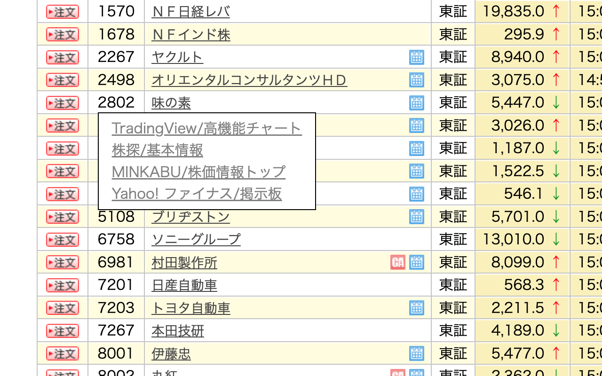
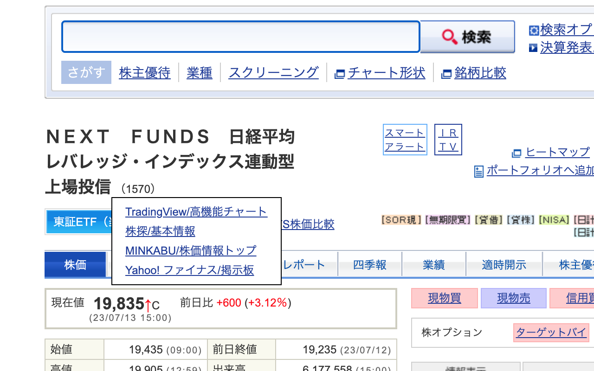
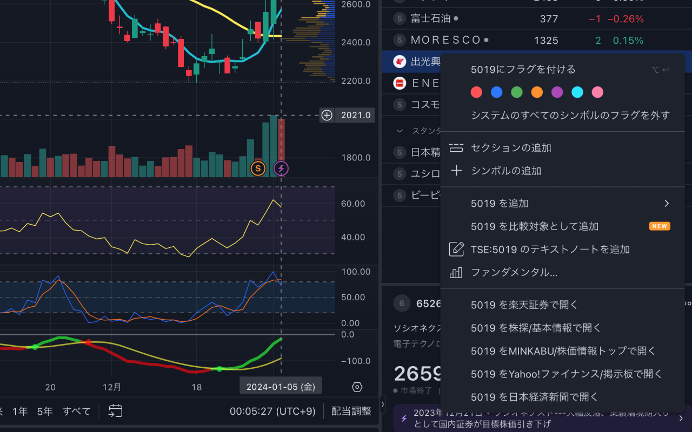
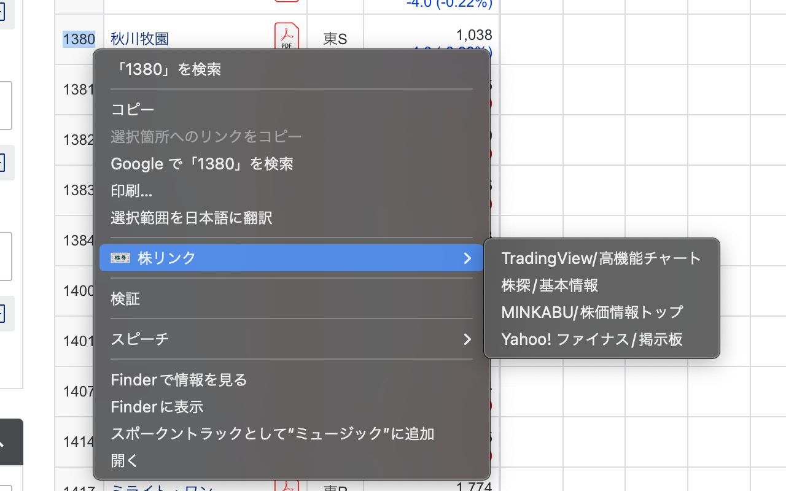
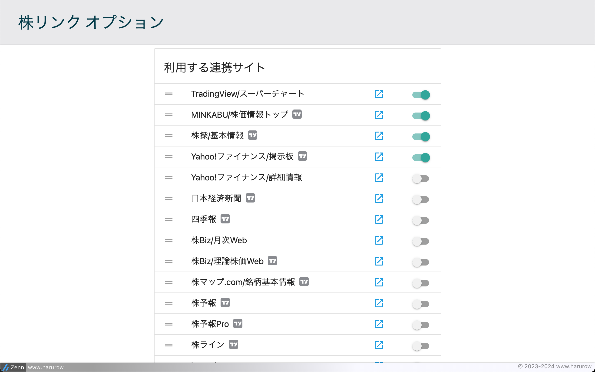

# Chrome拡張 株リンク

楽天証券・SBI証券・TradingView のページに、外部の株式情報サイトへのリンクメニューを追加する Chrome 拡張機能です。

- 銘柄コードにカーソルを合わせると「TradingView」「株探」「MINKABU」「Yahoo!ファイナンス」などへのリンクメニューが表示されます
- 文字列を選択したときの右クリックメニューからも同じサイトへ検索できます
- 表示する連携サイトと並び順はオプションページで設定できます

解説記事: [Chrome拡張で株の取引を便利にした](https://zenn.dev/harurow/articles/058760a7239236)

## 対応サイト

### 楽天証券

以下のページの銘柄コードにカーソルを合わせるとリンクメニューが出ます。

* お気に入り / お気に入り編集
* 保有商品一覧（すべて・国内株式）
* ランキング（売買代金・出来高・値上り値下り・信用残・積立・楽天内）
* 国内株式・個別銘柄 / 株価検索
* スーパースクリーナー



対応URL

```text
https://*.rakuten-sec.co.jp/*
https://hs.trkd-asia.com/rakutensecscr/*
```

### SBI証券

* 国内株式・個別銘柄
* ポートフォリオ
* 銘柄スクリーニング



対応URL

```text
https://*.sbisec.co.jp/ETGate/*
https://*.sbi.ifis.co.jp/*
https://graph.sbisec.co.jp/sbiscreener/*
```

### TradingView

チャート上の右クリックメニューと、ツールバーの「株Link」ボタンから各サイトへ遷移できます。

* 楽天証券にログイン中のタブがある場合は「楽天証券で開く」が追加されます
* 内藤証券で国内株マーケットの個別銘柄を開いている場合は「内藤証券で開く」が追加されます
* 米国株（英字1〜5文字）は米国株URLを持つサイトのみ表示されます



対応URL

```text
https://jp.tradingview.com/*
```

### 右クリックメニュー

文字列を選択したときのコンテキストメニューに各サイトへの項目を追加します。
選択範囲の先頭が銘柄コード（国内4桁 / 米国英字1〜5文字）と解釈できる場合のみ画面が開きます。



## 遷移先

オプションページで、利用するサイトと表示順を設定できます。
デフォルトでは全て有効なのでメニューが長くなります。利用するものに絞ってください。



以下は銘柄コード `7203`（トヨタ自動車）の例です。

* [TradingView/スーパーチャート](https://jp.tradingview.com/chart/?symbol=TSE%3A7203) ※米国株対応
* [MINKABU/株価情報トップ](https://minkabu.jp/stock/7203) ※米国株対応
* [株探/基本情報](https://kabutan.jp/stock/?code=7203) ※米国株対応
* [Yahoo!ファイナンス/詳細情報](https://finance.yahoo.co.jp/quote/7203.T) ※米国株対応
* [Yahoo!ファイナンス/掲示板](https://finance.yahoo.co.jp/quote/7203/bbs) ※米国株対応
* [moomoo証券](https://www.moomoo.com/ja/stock/7203-JP) ※米国株対応
* [日本経済新聞](https://www.nikkei.com/nkd/company/?scode=7203)
* [四季報](https://shikiho.toyokeizai.net/stocks/7203)
* [株Biz/理論株価Web](https://kabubiz.com/riron/7000/7203.php)
* [株Biz/月次Web](https://kabubiz.com/getuji/code/7203.php)
* [株マップ.com/銘柄基本情報](https://jp.kabumap.com/servlets/kabumap/Action?SRC=basic/top/base&codetext=7203)
* [株予報](https://kabuyoho.ifis.co.jp/index.php?action=tp1&sa=report&bcode=7203)
* [株予報Pro](https://kabuyoho.jp/reportTop?bcode=7203)
* [株ライン](https://kabuline.com/search/tw/7203)
* [karauri.net](https://karauri.net/7203/)
* [シェアードリサーチ](https://sharedresearch.jp/ja/companies/7203)
* [証券リサーチセンター](https://holistic-r.org/report/7203/)
* [投資の森](https://nikkeiyosoku.com/stock/7203/)
* [バフェット・コード](https://www.buffett-code.com/company/7203/)
* [目標株価まとめ](https://www.kabuka.jp.net/rating/7203.html)
* [Ullet](https://www.ullet.com/7203.html)
* [logmi](https://finance.logmi.jp/companies?query=7203)

## プライバシー

* 収集・送信する個人情報はありません
* 外部リソースを実行時に取得しません（フォント・アイコンはすべて同梱）
* 楽天証券・内藤証券への遷移は、**ユーザーが既に開いているログイン済みタブの URL** から
  セッション情報を読み取って組み立てます。そのため `tabs` 権限を使用します。
  ログインしていない場合はメニュー自体が表示されません

## 開発

```bash
npm install
npx playwright install chromium   # 初回のみ

npm run lint:all    # ESLint + Stylelint
npm run validate    # manifest.json の検証
npm test            # Playwright による UI テスト
npm run check       # 上記すべて
npm run package     # dist/kabu-tantan-<version>.zip を作成
npm run docs:tests  # テスト一覧 (docs/TEST-CATALOG.md) を再生成
npm run approve     # レビュー承認を記録する（コミットに必須）
```

ビルドステップはありません。`chrome://extensions/` の「パッケージ化されていない拡張機能を読み込む」で
`src/` を指定すればそのまま動作します。

### 開発フロー

要件定義 → 設計 → 実装 → レビュー の順に、担当を分けたエージェント（`.claude/agents/`）で進めます。
**すべてのテストが通り、かつレビューが通るまでコミットできません**（`.claude/hooks/commit-gate.sh` が強制）。

詳細は [docs/WORKFLOW.md](docs/WORKFLOW.md)。

### ドキュメント

| | |
| --- | --- |
| 開発ガイド（規約・注意事項） | [CLAUDE.md](CLAUDE.md) |
| ドキュメント索引 | [docs/README.md](docs/README.md) |
| 開発フロー・エージェント | [docs/WORKFLOW.md](docs/WORKFLOW.md) |
| 要件定義 | [docs/requirements/](docs/requirements/) |
| 仕様書 | [docs/specs/](docs/specs/) |
| アーキテクチャ | [docs/ARCHITECTURE.md](docs/ARCHITECTURE.md) |
| テスト方針・3層の切り分け | [docs/TESTING.md](docs/TESTING.md) |
| **テスト一覧（何をテストしているか）** | [docs/TEST-CATALOG.md](docs/TEST-CATALOG.md) |
| 手動確認チェックリスト | [docs/MANUAL-CHECKLIST.md](docs/MANUAL-CHECKLIST.md) |

### テスト

拡張機能を実際に Chromium へロードして検証する Playwright テストが **47件**あります。
証券会社へのログインは不要です（`context.route()` で対象オリジンにフィクスチャを返すため）。

内訳と、それぞれが何を守っているかは [docs/TEST-CATALOG.md](docs/TEST-CATALOG.md) を参照してください。

## ライセンス

MIT License — [LICENSE](LICENSE)

ソースは公開しています: <https://github.com/Harurow/chrome.ext.kabu-tantan>
