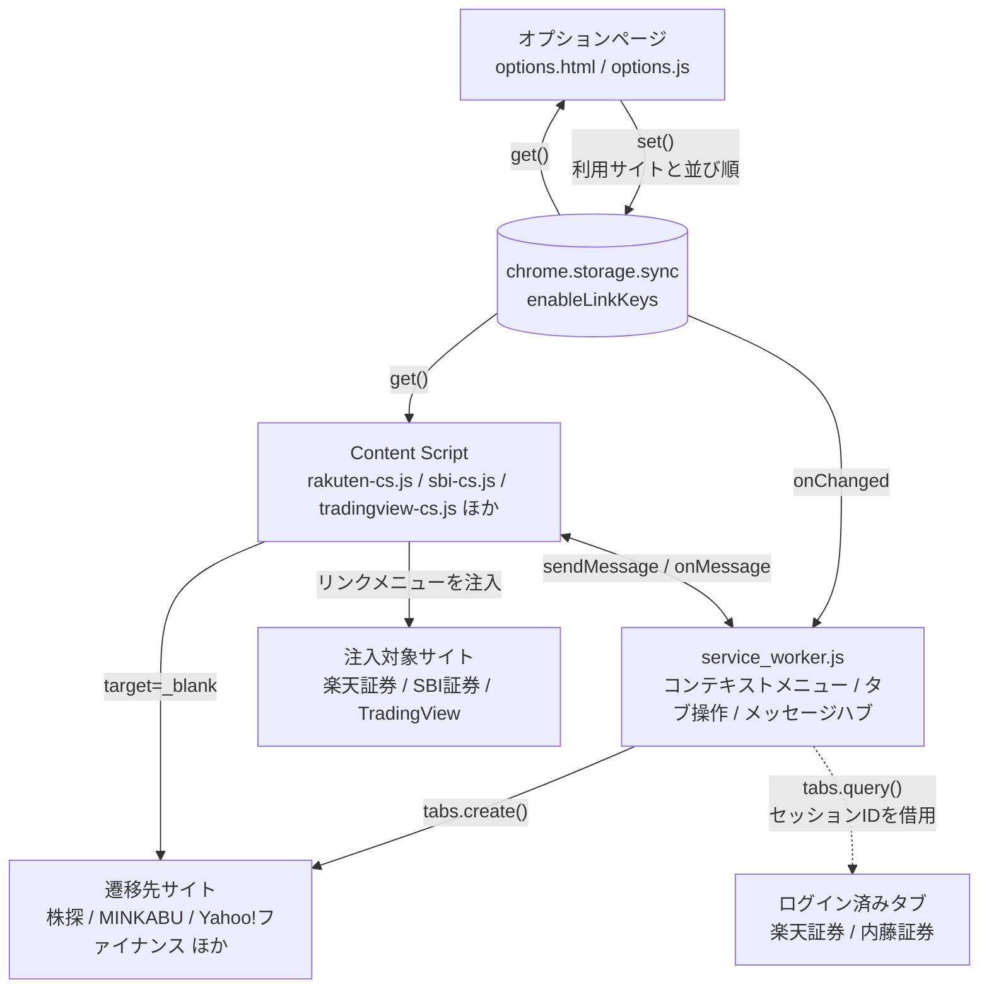

# アーキテクチャ

## 全体像



### 処理の流れ

| # | きっかけ | 動き |
| --- | --- | --- |
| 1 | 利用者がオプションページで設定を保存 | `chrome.storage.sync` に `enableLinkKeys` を書く |
| 2 | storage が変わった | Service Worker が `onChanged` で検知し、コンテキストメニューを作り直す |
| 3 | 対象サイトを開いた | Content Script が storage を読み、銘柄コードにメニューを注入する |
| 4 | メニューを選んだ | 新しいタブで遷移先サイトを開く |
| 5 | TradingView で証券会社連携を使った | Content Script が Service Worker に問い合わせ、ログイン済みタブの URL からセッションIDを借りて遷移先を組み立てる |

## モジュール共有の仕組み

**ビルドが無いため ES モジュールは使えない。** スクリプト間の値の共有は
`manifest.json` の `js` 配列の読み込み順に依存する。

```json
"js": [
  "third-party/jquery.min.js",  // $ を定義
  "urls.js",                    // externalUrls / externalUrlsMap / getEnableLinkKeysAsync / makeUrl
  "linkMenu.js",                // createMenu（urls.js に依存）
  "rakuten-cs.js"               // 上記すべてを使う
]
```

Service Worker だけは `importScripts('./urls.js')` で読み込む。

この暗黙の依存は壊れても実行時まで気づけないため、`npm run validate` が読み込み順を検証する。
ESLint 側は `eslint.config.mjs` の `sharedGlobals` でこれらをグローバル宣言している。

## 銘柄コードの扱い

国内銘柄コードは **4桁**だが、2024年以降の英字含みコード（例: `135A`）に対応するため
正規表現は `[0-9][0-9ACDFGHJKLMNPRSTUWXY][0-9][0-9ACDFGHJKLMNPRSTUWXY]` を使う
（2桁目・4桁目に使われる英字が限定されている東証の採番規則に対応）。

米国株は `[A-Z]{1,5}`。**必ず先頭にアンカー (`^`) を付ける** ——
付けないと日本語文中の大文字並び（例: 「株価はNYSEで上昇」）に誤マッチする。

### URL テンプレート

`urls.js` のプレースホルダは `makeUrl()` が展開する。

| プレースホルダ | 展開結果 |
| --- | --- |
| `${code}` | 銘柄コードそのもの |
| `${code:0}` | 銘柄コードの先頭1文字（株Biz の階層 URL 用） |
| `${exchange}` | 取引所コード（`NASDAQ` / `NYSE`）。`url2` でのみ使う |

| フィールド | 用途 |
| --- | --- |
| `url0` | トップページ。オプション画面の「開く」リンク |
| `url1` | 国内株（必須） |
| `url2` | 米国株・取引所コードあり（任意） |
| `url3` | 米国株・取引所コードなし（任意） |

`url3` が無いサイトは TradingView の米国株メニューに出ない（`tradingview-cs.js`）。

## 証券会社セッションの利用

楽天証券・内藤証券は**ログイン済みタブの URL からセッション情報を borrow する**方式を取る。

- 楽天証券: `chrome.tabs.query({url: 'https://member.rakuten-sec.co.jp/*'})` で開いているタブを探し、
  URL 中の `BV_SessionID` を取り出して個別銘柄ページの URL を組み立てる
- 内藤証券: `https://*.qhit.net/naito/iswebptt2/*` のタブを探し、URL 中の `qcode` を差し替える

このため `permissions` に `tabs` が必要。**全タブの URL を読める強い権限**なので、
Chrome ウェブストア審査ではこの用途を明示する必要がある。ログインしていなければ
メニュー自体が出ない（`null` が返る）。

## 同梱ライブラリ (`src/third-party/`)

| ファイル | ライブラリ | バージョン | 用途 |
| --- | --- | --- | --- |
| `jquery.min.js` | jQuery | 4.0.0 | 全 Content Script / オプション |
| `jquery-ui.min.js` | jQuery UI | 1.14.2 | オプション画面の `sortable` のみ |
| `materialize.min.css` | @materializecss/materialize | 2.3.3 | オプション画面のスタイル（CSS のみ） |
| `material-icons.woff2` | Material Icons | — | アイコンフォント本体（`material-icons.css` は自作なので `src/` 直下） |

### 更新手順

```bash
# jQuery
curl -L -o src/third-party/jquery.min.js https://code.jquery.com/jquery-<ver>.min.js

# jQuery UI / Materialize は npm パッケージから dist を取り出す
npm pack jquery-ui@<ver> && tar xzf jquery-ui-<ver>.tgz
cp package/dist/jquery-ui.min.js src/third-party/

npm pack @materializecss/materialize@<ver> && tar xzf materializecss-materialize-<ver>.tgz
cp package/dist/css/materialize.min.css src/third-party/

npm test   # 差し替え後は必ず実行する
```

### 注意点

- **Materialize の JS は同梱していない。** `M.*` API を使っていないため不要
  （2.x で `waves-effect` も廃止された）。CSS だけで足りる。
- **Materialize 2.x の `.row` は CSS Grid。** 1.0 の `.col` クラスは廃止され、
  `.row .sN` が `grid-column` を持つ。**`.sN` は `.row` の直接の子でなければ効かない。**
  `tests/options.spec.mjs` に回帰テストがある。
- **jQuery 4.0.0 で使用中の API はすべて健在。** 位置擬似クラス (`:first` / `:eq()`)、
  `:contains()`、非標準の `[attr!="x"]`、`.hover()` とイベントショートハンドは削除されていない。
- Material Icons は **Google Fonts CDN を使わずローカル同梱**している。
  実行時の外部リクエストはゼロ（`tests/options.spec.mjs` で保証）。
  `@font-face` を書いた `src/material-icons.css` は**自作なので `third-party/` に置かない**
  （置くと Stylelint の検査対象から外れる）。

## ファイル変更時の影響範囲

| 変更ファイル | 影響 |
| --- | --- |
| `src/urls.js` | 全 Content Script + Service Worker + オプションページ |
| `src/linkMenu.js` | 楽天・SBI の Content Script |
| `src/service_worker.js` | コンテキストメニュー、メッセージ通信全体 |
| `src/style.css` | 楽天・SBI のメニュー表示 |
| `src/tradingview-cs.css` | TradingView のみ |
| `src/manifest.json` | 拡張機能全体（権限、Content Script 注入先） |
| `src/third-party/*` | 全体。差し替え後は `npm test` 必須 |

## Material Icons のサブセット

`material-icons.woff2` は**使用しているアイコンだけにサブセット化**してある (128KB → 32KB)。

```bash
# 1. Google Fonts から full 版の woff2 を取得
curl -sS -A "Mozilla/5.0 ... Chrome/140.0 ..." \
  "https://fonts.googleapis.com/icon?family=Material+Icons" | grep -oE "https://[^)]+\.woff2"
curl -L -o /tmp/mi-full.woff2 "<上で得た URL>"

# 2. 使用中のアイコン名を列挙して subset する
#    ⚠️ このフォントのリガチャは liga ではなく rlig（必須リガチャ）
python3 -m fontTools.subset /tmp/mi-full.woff2 \
  --text="drag_handle open_in_new save show_chart" \
  --layout-features=rlig,liga \
  --flavor=woff2 \
  --output-file=src/third-party/material-icons.woff2

npm test   # リガチャが効いているかを実測で検証する
```

**アイコンを追加したら `--text` に足して再サブセットすること。**
忘れるとリガチャが効かず、アイコン名の文字列がそのまま表示される
（`tests/options.spec.mjs` の幅実測テストが検出する）。
