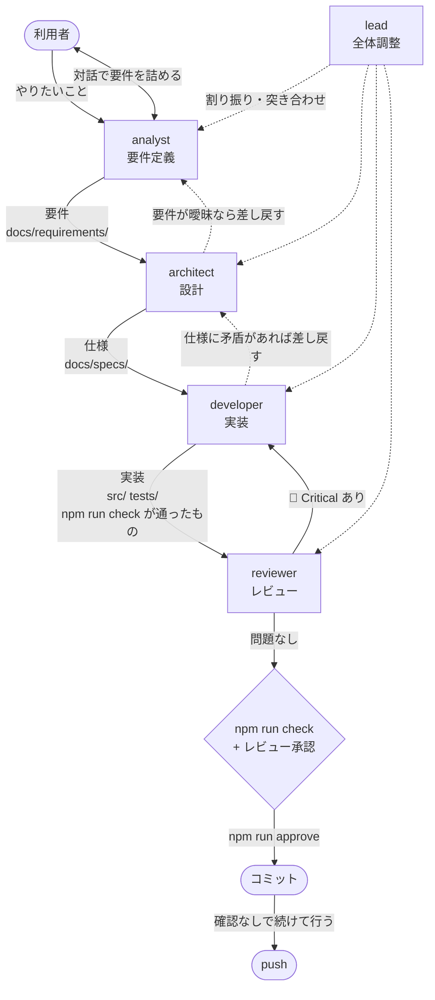
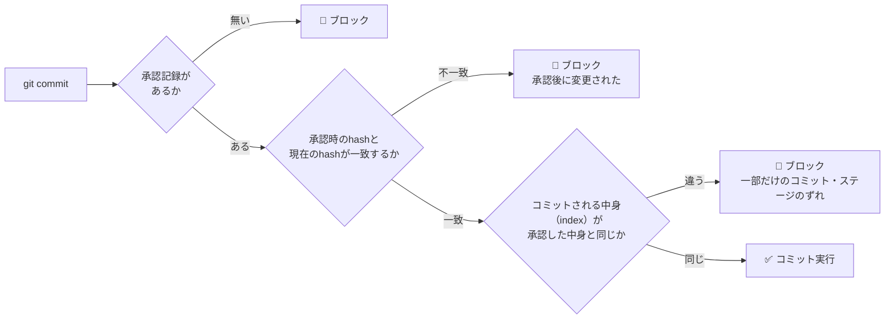

# 開発フロー

要件定義 → 設計 → 実装 → レビュー → コミット → push の順に進める。
工程ごとの担当エージェントの定義は `.claude/agents/` にある（どれを使うかは「[サブエージェントに渡す基準](#サブエージェントに渡す基準)」）。

## 全体の流れ



担当に渡すかどうかは、変更の大きさではなく下の「サブエージェントに渡す基準」で決める。
渡さずにメインセッションが自分で書くときも、要件・仕様・ADR・テストの文書は、担当が書くときと同じように更新する。
**レビュー（`reviewer`）とコミットゲートは省かない。**

## サブエージェントに渡す基準

メインセッション（利用者と直接やり取りしている AI）は、担当を指定せずに起動したなら、担当の書き換え範囲に縛られない
（`src/third-party/` を編集しないなど、ほかの規則には従う）。
`claude --agent <担当>` で起動したときは、その担当の定義に従う。
サブエージェントに渡すのは、次のどれかに当たるときだけにする（利用者の全プロジェクト共通の指示 `~/.claude/CLAUDE.md` に合わせた）。

| 渡すとき | 例 |
| --- | --- |
| 独立した確認になる | レビュー。**`reviewer` には必ず渡す** |
| 互いに独立した作業を並行させて、時間を縮められる | 仕様の整理と、別の箇所の実装を同時に進める |
| 利用者が工程を回すと決めた | 利用者が `claude --agent lead` / `claude --agent analyst` で起動した |

渡すときは、目的・許可範囲・書き換えてよい場所・完了の条件・読むべき資料（ファイルと ID）・分かっている阻害を伝える。
返ってきた結果はそのまま信じず、自分で確かめて（差分を読む・テストの結果を見る）から取り込む。

## エージェント

| エージェント | 役割 | model | 書き換えてよい場所 |
| --- | --- | --- | --- |
| `lead` | 全体調整。工程を回す | opus | なし（自分では作らない） |
| `analyst` | 利用者と対話して要件を決める | opus | `docs/requirements/` |
| `architect` | 要件から設計・仕様を起こす | opus | `docs/requirements/`, `docs/specs/`, `docs/ARCHITECTURE.md`, `docs/adr/` |
| `developer` | 仕様に従って実装する | opus | `src/`, `tests/`, `scripts/`, ルート設定 |
| `reviewer` | 実装と文書を突き合わせて検証する | opus | **なし（読み取り専用）** |

- **サブエージェントは役割をまたいで変えない。** developer は仕様書を書かない。architect は実装しない
- `reviewer` は `tools` に `Write` / `Edit` を持たない。ただし `Bash` は持つので、書き換えないことは定義の指示で禁じている（道具の側の保証ではない）
- `AGENTS.md`・`docs/README.md`・`docs/WORKFLOW.md`・`docs/TESTING.md`・`docs/MANUAL-CHECKLIST.md`・`.claude/` は、どの担当の書き換え範囲にも入れない。
  書くのはメインセッション。サブエージェントは、書くべきことに気づいたら報告に書いて渡す
- `docs/TEST-CATALOG.md` は生成物。テストを増減したら（developer か、自分で書いたメインセッションが）`npm run docs:tests` で作り直す

### モデルの選定理由

全エージェントを opus にしている。理由:

- `analyst` / `architect` — 曖昧な要望を判定可能な形に落とす、制約とのトレードオフを判断する。抽象度が高い
- `reviewer` — 見落としが致命的。特に他社サイト注入まわりの死にコード判定は、
  grep 結果だけで判断すると壊す
- `developer` — 仕様が明確でも、このコードベースには
  「ビルド無しのグローバル共有」「jQuery 独自セレクタ」「Materialize のグリッド仕様」など
  暗黙の罠が多い。安いモデルだと踏む
- `lead` — 工程の判断と差し戻しの判断

`analyst` / `architect` / `reviewer` は `effort: high` を追加している（掘り下げと網羅性が要るため）。

> コストを下げたい場合、最初に落とす候補は `developer` を `sonnet` にすること。
> ただし `reviewer` は opus のまま残すこと（安全網なので）。

## ⚠️ analyst の対話制約

**`AskUserQuestion` は全サブエージェントから強制的に除去される。**
そのため `analyst` の使い方が2通りに分かれる。

| 起動方法 | 対話 | 使いどころ |
| --- | --- | --- |
| `claude --agent analyst` | **できる** | 腰を据えて要件を詰めるとき。**推奨** |
| `lead` から呼ぶ（メインセッションが並行作業として呼ぶときも同じ） | できない | 要件ドラフトと確認事項リストを返させる |

サブエージェントとして呼んだ場合、`analyst` は要件を確定させず、
**確認事項を列挙して返す**。それを `lead`（またはメインセッション）が利用者に聞いて返す。

## 使い方

```bash
claude --agent analyst   # 要件を決める（書き終えたら、レビューからコミット・push まで行う）
claude --agent lead      # 工程をまとめて回す
```

利用者が `claude --agent` で単発に起動してもよい:

- 仕様だけ整理したい → `architect`
- 仕様が決まっている実装 → `developer`
- 既存コードの点検 → `reviewer`

`architect` と `developer` はコミットしない（定義に従う）。レビューからコミット・push までは、
担当を指定しないメインセッションか `lead` で行う（`analyst` は自分で行う）。

`analyst` と `lead` の `tools` にある `Agent(...)` の種類の制限は、`claude --agent` でメインとして動かしたときだけ効く。
サブエージェントとして呼ばれたときは括弧の中が無視され、どの種類のエージェントも呼べる（深さの上限は既定で3層。
2026-10-12 に[公式ドキュメント](https://code.claude.com/docs/en/sub-agents)で確認）。
サブエージェントとして呼ばれた `analyst` が `Agent` を使わないのは、定義の指示で止めている。

## コミットゲート

**すべてのテストが通り、かつレビューが通るまでコミットできない。**
これは口約束ではなく `.claude/hooks/commit-gate.sh`（PreToolUse フック）が機械的に強制する。



### 手順

```bash
# 0. 修正し、テストを書き足して流す（途中は関係するテストだけでよい）
# 1. reviewer のレビューを通す（🔴 Critical が無いこと）
# 2. 承認を記録する（同じ作業ツリーで npm run check が通った記録が無ければ、ここで流す。
#    変更が文書だけなら npm run check:docs だけを流す）
npm run approve "レビュー通過。SPEC-CS-09 の修正"

# 3. 変更をすべてコミットする（2 とは別の Bash 呼び出しで）
git commit -m "..."

# 4. push する（利用者への確認は不要。テストは 2 で済んでいるので流し直さない）
git push
```

`npm run approve && git commit …` のように1回の呼び出しにまとめると、フックが承認前の状態で判定して止める。
手順の詳細と経緯は [AGENTS.md](../AGENTS.md)「修正したら、テスト → レビュー → テスト → コミット → push までをセットで行う」。

### 承認は変更内容に紐づく

`npm run approve` は現在の作業ツリーのハッシュ（変更をすべて、未追跡のファイルも含めてコミットしたときにできる tree の ID。
一時的な index で求めるので、ステージの状態によらず作業ツリーの中身だけで決まる）を
`.claude/review-approved.json` に記録する。

**承認後にファイルを1文字でも変えると承認は無効になり、コミットがブロックされる。**
レビューをやり直して再度 `npm run approve` を実行する必要がある。

承認は HEAD にも結びつく（承認のファイルの `head`）。ハッシュは作業ツリーの中身なので、コミットしても変わらない。
HEAD も比べることで、**承認は1回のコミットで使い切られ**、そのあとの revert・merge・cherry-pick・2回目のコミットは、承認をやり直すまで止まる。

### コミットされる中身を確かめる

`git commit` のときは、作業ツリーに加えて、**実際にコミットされる中身（index）**も承認した中身と比べる（2026-10-14 利用者判断）。
作業ツリーだけを比べていたときは、一部だけステージした・ステージしてから作業ツリーを戻した・パスを指定した、
といったコミットで、テストしていない中身が履歴に入りえた。確かめ方は chrome.ext.love-g-rss-reader のコミットゲートと同じ。

- コミットされる中身は、本物の index の写しで求める（本物の index は触らない）。同じ呼び出しで前に `git add -A` があればそれを足し、
  `git commit -a` なら追跡しているファイルの変更を足す（`-a` は未追跡のファイルを入れないので、未追跡のファイルがあれば止まる）
- パスを指定したコミットや、一部だけのコミット（`-o` / `-i` / `-p` / `--pathspec-from-file`）は止める
- `git commit` の前に置けるのは `git add -A` と、読むだけのコマンド（`git status` / `diff` / `log` / `show` / `rev-parse`、`cd`・`echo`・`cat`・`grep` など）だけ。
  ファイルへ書き出すリダイレクトがあるものも止める（フックは実行の前に判定するので、前で作業ツリーが変わると判定がずれる）
- 1回の呼び出しで `git commit` を2回以上行うもの、シェル（`bash -c`）やラッパー（`xargs` など。足すパスが見えない）を介した `git commit`、
  `git -C` / `--git-dir` / `--work-tree` / `-c core.worktree=` / `GIT_DIR=` などで場所を変えた `git commit` は止める
- ヒアドキュメントの中身（コミットメッセージ）はコマンドとして読まない。ただし取り除くのは、引用符の外の `<<` で始まり、
  区切りの直後が行末・空白・演算子で（`<<E"O"F` のような一部だけの引用は読まない）、
  終わりの行が見つかったものだけ（取り除き過ぎると、承認の無い `git commit` を隠して通してしまう）。引用符の中の `<` `>` はリダイレクトとして読まない
- 判定は `.claude/hooks/commit-gate.mjs` と `scripts/lib/change-hash.mjs`、テストは `tests/commit-gate.spec.mjs`

コミットは `git add -A && git commit -F - <<'EOF' … EOF` の形で行う（`npm run approve` とは別の呼び出し）。

### 全件のチェックを同じ作業ツリーで2回流さない

`npm run check` は、通ったときの作業ツリー（HEAD と、承認と同じ計算のハッシュ）を `.claude/check-passed.json` に記録する。
`npm run approve` は、今の作業ツリーがこの記録と同じなら全件（約3分）を流し直さずに承認する。違えば今までどおり流す
（2026-10-12 利用者判断。レビューで流した全件と approve が、同じ作業ツリーで続けて2回流していた）。

- 記録は流す前に消し、通ったときだけ書く。落ちた・中断したときは残らない
- チェックの前と後で作業ツリーを比べ、変わっていたら、通っても記録せず失敗にする（どの状態で通ったか分からないため。
  途中で変わって元に戻ったものは見分けない）。approve が流したときも、流したあとの作業ツリーの記録が無ければ承認しない
- `npm run check` はテストを `--forbid-only` で流す。`test.only` が残っていると、一部のテストだけで通った記録が残るため
- `EXTENSION_PATH` を指定したときは、作業ツリーの `src/` を試していないので記録しない
- ハッシュは作業ツリーの中身（tree の ID）なので、HEAD も合わせて比べる（同じ中身でも、別の HEAD の上なら別の状態として扱う）。
  `.gitignore` で無視されるもの（`node_modules/` など）の違いは見ない（承認のハッシュと同じ）
- 判定は `scripts/lib/check-record.mjs`、テストは `tests/check-record.spec.mjs`

### 文書だけの変更は文書の検査だけで承認する

変更が文書だけなら、`npm run approve` はテスト全件を流さず、`npm run check:docs`（`lint:md` とテストカタログの陳腐化検査。数秒）だけを流して承認する
（2026-10-14 利用者判断。`src/` も `tests/` も変えていない要件の文書の記録で、全件（約3分）を流していた）。

文書だけとみなすのは、HEAD からの変更（ステージ済み・未ステージ・削除・未追跡。名前の変更は元と先の両方）がすべて次を満たすとき:

- Markdown（`.md`）である
- `src/`・`tests/`・`scripts/` の外にある
- `tests/` と `scripts/` のどのファイルにも、その名前が書かれていない。
  テストが読む文書（`tests/selector-defs.spec.mjs` は `docs/MANUAL-CHECKLIST.md` を読む）を変えると、テストの結果が変わりうるため。
  コメントで触れているだけのものも全件に倒す（例: `MANUAL-CHECKLIST.md`・`WORKFLOW.md`。どれが当たるかは `tests/` と `scripts/` の中身で決まる）。
  ステージ済みの変更も見る（ステージしてから作業ツリーだけ戻したコードの変更を漏らさないため）

ひとつでも外れれば、今までどおり全件を流す（同じ作業ツリーの記録があれば使い回す）。

- 文書の検査の前と後で作業ツリーが変わっていたら、通っても承認しない
- 文書の検査では全件の記録（`.claude/check-passed.json`）を書かない（記録は「全件が通った」を表すため）
- 承認のファイル（`.claude/review-approved.json`）に `docsOnly: true` を残す
- reviewer も、文書だけの変更では全件ではなく `npm run check:docs` を流す
- 判定は `scripts/lib/docs-only.mjs` と `scripts/lib/check-record.mjs`、テストは `tests/check-record.spec.mjs`

### このゲートが保証すること / しないこと

| | |
| --- | --- |
| ✅ 保証する | 承認した作業ツリーで `npm run check`（lint + validate + テスト全件）が通っていること（approve で流したか、同じ作業ツリーで通った記録による）。**文書だけの変更では、`npm run check:docs` が通っていることだけ**（テストの結果を変えうる変更が無いことは、上の判定に任せる） |
| ✅ 保証する | 承認後にコードが変更されていないこと |
| ✅ 保証する | `git commit` でコミットされる中身（index）が、承認した作業ツリーの中身と同じこと（一部だけのコミット・ステージのずれを止める。上の「コミットされる中身を確かめる」） |
| ❌ 保証しない | **`reviewer` に実際に見せたかどうか** |

`npm run approve` は「テストが通ったこと」しか機械的に確認できない。
**レビューを通したかは、コミットするセッション（メインセッション・`lead`・`analyst`）と利用者の責任。** 工程を飛ばして `approve` しないこと。

### 検出するコマンド

トークン単位で解析し、**コミットを新しく作る**コマンドを検出する。

| 検出する | 通す |
| --- | --- |
| `git commit` / `revert` / `merge` / `cherry-pick` / `rebase` / `am` | `git log --grep="git commit"` |
| `FOO=bar git commit`（環境変数プレフィックス） | `git commit --dry-run` |
| `git -c user.name=x commit`（グローバルオプション） | `git merge --abort` / `rebase --abort` / `--skip` |
| `cd /tmp && git commit` | `git status` / `git diff` / `git show` |
| `bash -c 'git commit'` / `sh -c "git revert"` | `echo "run git commit later"` |
| `npm version patch`（内部で commit する） | `grep -r commit src/` |

`git commit` は、検出したうえで「コミットされる中身を確かめる」の条件も見る（シェルを介したものは、承認があっても止める）。

`.claude/hooks/commit-gate.sh`（高速パス）→ `.claude/hooks/commit-gate.mjs`（解析）の2段構成。
判定できない場合（node が無い、JSON が壊れている、ハッシュ計算に失敗）は
**通さない（fail-closed）**。

### 制限

- シェルエイリアス（`gc` など）経由のコミットは検出できない
- Bash ツールを経由しない方法（GUI クライアント等）も検出できない

## 参照

- エージェント定義: `.claude/agents/`
- フック: `.claude/hooks/commit-gate.sh`（高速パス）, `.claude/hooks/commit-gate.mjs`（解析）, `.claude/settings.json`
- 承認スクリプト: `scripts/approve.mjs`, `scripts/check.mjs`, `scripts/lib/check-record.mjs`, `scripts/lib/change-hash.mjs`, `scripts/lib/docs-only.mjs`
- ドキュメント索引: [README.md](README.md)
