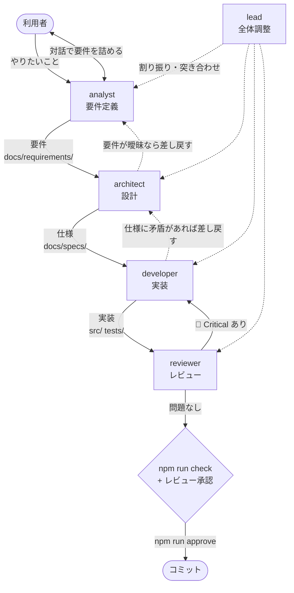
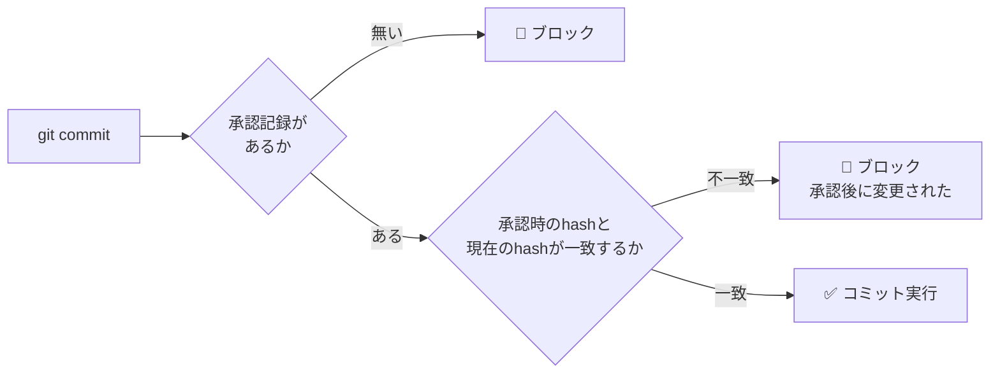

# 開発フロー

要件定義 → 設計 → 実装 → レビュー → コミット の順に、担当を分けたエージェントで進める。
定義は `.claude/agents/` にある。

## 全体の流れ



## エージェント

| エージェント | 役割 | model | 書き換えてよい場所 |
| --- | --- | --- | --- |
| `lead` | 全体調整。工程を回す | opus | なし（自分では作らない） |
| `analyst` | 利用者と対話して要件を決める | opus | `docs/requirements/` |
| `architect` | 要件から設計・仕様を起こす | opus | `docs/specs/`, `docs/ARCHITECTURE.md` |
| `developer` | 仕様に従って実装する | opus | `src/`, `tests/`, `scripts/`, ルート設定 |
| `reviewer` | 実装と文書を突き合わせて検証する | opus | **なし（読み取り専用）** |

`reviewer` は `tools` に `Write` / `Edit` を持たない。**書き換えられないことがツールレベルで保証されている。**

### モデルの選定理由

全エージェントを opus にしている。理由:

- `analyst` / `architect` — 曖昧な要望を判定可能な形に落とす、制約とのトレードオフを判断する。抽象度が高い
- `reviewer` — 見落としが致命的。特に他社サイト注入まわりの死にコード判定は、
  grep 結果だけで判断すると壊す
- `developer` — 仕様が明確でも、このコードベースには
  「ビルド無しのグローバル共有」「jQuery 独自セレクタ」「Materialize のグリッド仕様」など
  暗黙の罠が多い。安いモデルだと踏む
- `lead` — 工程の判断と差し戻しの判断

`analyst` / `architect` / `reviewer` は `effort: high` を追加している（掘り下げと網羅性が要るため）。

> コストを下げたい場合、最初に落とす候補は `developer` を `sonnet` にすること。
> ただし `reviewer` は opus のまま残すこと（安全網なので）。

## ⚠️ analyst の対話制約

**`AskUserQuestion` は全サブエージェントから強制的に除去される。**
そのため `analyst` の使い方が2通りに分かれる。

| 起動方法 | 対話 | 使いどころ |
| --- | --- | --- |
| `claude --agent analyst` | **できる** | 腰を据えて要件を詰めるとき。**推奨** |
| `lead` などから呼び出す | できない | 要件ドラフトと確認事項リストを返させる |

サブエージェントとして呼んだ場合、`analyst` は要件を確定させず、
**確認事項を列挙して返す**。それを `lead`（またはメインセッション）が利用者に聞いて返す。

## 使い方

### 腰を据えて要件から決める

```bash
claude --agent analyst
```

対話で要件を確定させたあと、通常セッションに戻って `lead` に渡す。

### 工程をまとめて回す

```bash
claude --agent lead
```

または通常セッションから `lead` エージェントを呼ぶ。

### 単発で使う

- 仕様だけ整理したい → `architect`
- 仕様が決まっている実装 → `developer`
- 既存コードの点検 → `reviewer`

## コミットゲート

**すべてのテストが通り、かつレビューが通るまでコミットできない。**
これは口約束ではなく `.claude/hooks/commit-gate.sh`（PreToolUse フック）が機械的に強制する。



### 手順

```bash
# 1. reviewer のレビューを通す（🔴 Critical が無いこと）
# 2. 承認を記録する（npm run check も自動で実行される）
npm run approve "レビュー通過。SPEC-CS-09 の修正"

# 3. コミット
git commit -m "..."
```

### 承認は変更内容に紐づく

`npm run approve` は現在の作業ツリーのハッシュ（`git diff HEAD` + 未追跡ファイルの内容）を
`.claude/review-approved.json` に記録する。

**承認後にファイルを1文字でも変えると承認は無効になり、コミットがブロックされる。**
レビューをやり直して再度 `npm run approve` を実行する必要がある。

### このゲートが保証すること / しないこと

| | |
| --- | --- |
| ✅ 保証する | `npm run check`（lint + validate + テスト全件）が通っていること |
| ✅ 保証する | 承認後にコードが変更されていないこと |
| ❌ 保証しない | **`reviewer` に実際に見せたかどうか** |

`npm run approve` は「テストが通ったこと」しか機械的に確認できない。
**レビューを通したかは `lead` と利用者の責任。** 工程を飛ばして `approve` しないこと。

### 検出するコマンド

トークン単位で解析し、**コミットを新しく作る**コマンドを検出する。

| 検出する | 通す |
| --- | --- |
| `git commit` / `revert` / `merge` / `cherry-pick` / `rebase` / `am` | `git log --grep="git commit"` |
| `FOO=bar git commit`（環境変数プレフィックス） | `git commit --dry-run` |
| `git -c user.name=x commit`（グローバルオプション） | `git merge --abort` / `rebase --abort` / `--skip` |
| `cd /tmp && git commit` | `git status` / `git diff` / `git show` |
| `bash -c 'git commit'` / `sh -c "git revert"` | `echo "run git commit later"` |
| `npm version patch`（内部で commit する） | `grep -r commit src/` |

`.claude/hooks/commit-gate.sh`（高速パス）→ `.claude/hooks/commit-gate.mjs`（解析）の2段構成。
判定できない場合（node が無い、JSON が壊れている、ハッシュ計算に失敗）は
**通さない（fail-closed）**。

### 制限

- シェルエイリアス（`gc` など）経由のコミットは検出できない
- Bash ツールを経由しない方法（GUI クライアント等）も検出できない

## 参照

- エージェント定義: `.claude/agents/`
- フック: `.claude/hooks/commit-gate.sh`（高速パス）, `.claude/hooks/commit-gate.mjs`（解析）, `.claude/settings.json`
- 承認スクリプト: `scripts/approve.mjs`, `scripts/lib/change-hash.mjs`
- ドキュメント索引: [README.md](README.md)
