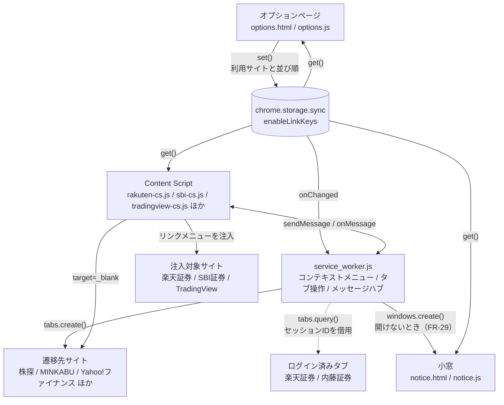

# アーキテクチャ

## 全体像



### 処理の流れ

| # | きっかけ | 動き |
| --- | --- | --- |
| 1 | 利用者がオプションページで設定を保存 | `chrome.storage.sync` に `enableLinkKeys` を書く |
| 2 | storage が変わった | Service Worker が `onChanged` で検知し、コンテキストメニューを作り直す |
| 3 | 対象サイトを開いた | Content Script が storage を読み、銘柄コードにメニューを注入する。**注入対象がまだ無ければ、現れるまで最大 30 秒試し直す**（SPEC-CS-22。1.13.0） |
| 4 | メニューを選んだ | 新しいタブで遷移先サイトを開く。**1.21.0〜（FR-29）:** Chrome の右クリックメニューで、選択した銘柄ではその遷移先を開けない（米国株で `url3` が無い）とき、または選択文字列を銘柄コードとして読めないときは、タブを開かず小窓 `notice.html` を開いて理由を出す（選択文字列は小窓に渡さない）（SPEC-SW-05 / SPEC-SW-10 / SPEC-NT） |
| 5 | TradingView で証券会社連携を使った | Content Script が Service Worker に問い合わせ、ログイン済みタブの URL からセッションIDを借りて遷移先を組み立てる |

## モジュール共有の仕組み

**ビルドが無いため ES モジュールは使えない。** スクリプト間の値の共有は
`manifest.json` の `js` 配列の読み込み順に依存する。

```json
"js": [
  "third-party/jquery.min.js",  // $ を定義
  "urls.js",                    // externalUrls / externalUrlsMap / exchanges / getEnableLinkKeysAsync / makeUrl / isExtensionAlive / retrySetup
                                // 1.17.0 で usCodePattern / jpLooseCodePattern / matchInjectionTicker を追加（未実装。FR-28）
  "linkMenu.js",                // createMenu（urls.js に依存）
  "rakuten-cs.js"               // 上記すべてを使う
]
```

Service Worker だけは `importScripts('./urls.js')` で読み込む。

**5本の Content Script すべてが読むのは `urls.js` だけ**（`linkMenu.js` は TradingView に読み込まれない）。
全 Content Script で共有したいものは `urls.js` に置く。
`isExtensionAlive()`（切断状態の判定。SPEC-CS-19）と `retrySetup()`（注入の再試行。SPEC-CS-22）を
ここに置いているのはこの理由による。

> `urls.js` は Service Worker からも `importScripts` で読まれるため、
> ここに置いた関数は `tests/service-worker.spec.mjs` から直接叩ける（ビルドが無い環境で唯一の単体テスト手段）。
>
> **`urls.js` に値を足したら `eslint.config.mjs` の `sharedGlobals` にも足す。**
> 足さないと、その値を使う側で `no-undef` が出る（1.17.0 で移す `usCodePattern` が該当。
> `service_worker.js` から宣言が消えるため、**移設と同時に列へ足さないと lint が落ちる**）。

この暗黙の依存は壊れても実行時まで気づけないため、`npm run validate` が読み込み順を検証する。
ESLint 側は `eslint.config.mjs` の `sharedGlobals` でこれらをグローバル宣言している。

## 検出用セレクタの単一情報源

サイト側の DOM を探すセレクタ（**検出用セレクタ**）は、`src/*-cs.js` の `menuSelectors` にだけ書く。
実サイトのセレクタ検証ツール（[SPEC-SC](specs/selector-check.md)）は、この配列を
`node:vm` で読み出して使う。**検証側にセレクタを書き写さない**（NFR-13）。

```text
src/rakuten-cs.js      const menuSelectors = [...]   ← 唯一の情報源
src/rakuten-scr-cs.js  const menuSelectors = [...]
src/sbi-cs.js          const menuSelectors = [...]
src/sbi-scr-cs.js      const menuSelectors = [...]
src/tradingview-cs.js  const menuSelectors = [...]   ← `menuSelectors` に括り出し済み（SPEC-CS-15）
        ↑ 読むだけ
scripts/selector-check/load-selectors.mjs
```

このため `src/*-cs.js` は以下の契約を守る。**破ると検証ツールが動かなくなる。**

1. 検出用セレクタは `const menuSelectors = [ … ]` という名前の配列に置く（1ファイル1箇所）
2. トップレベルで実行するのは `$(() => …)` の登録だけ。DOM・ネットワークに触れない
3. 各要素は `{ title, selector }` を持つ（楽天は `url`、TradingView は `key` を追加で持つ）
4. **検出用セレクタは `body` / `html` を起点にしない**（`body` / `html` に付いたクラス・属性を条件に使わない）。
   他の Chrome 拡張が印を付ける場所であり、サイト側のクラスと誤認すると
   その拡張を入れている環境でしか動かないセレクタになる（CON-11、SPEC-CS-21）
5. 検出用セレクタに**既知の他拡張クラス**（`vsc-initialized` など）を含めない（同上）

読み込み順を `npm run validate` で守るのと同じ発想で、この契約は `npm test`
（`tests/selector-defs.spec.mjs`）で守る。

実 DOM を見てセレクタを起こすときは、**株リンクだけを入れた Chrome** で開くこと。
他の拡張が付けたクラスをサイト側のものと取り違えた実例がある（`657f366` の `body.vsc-initialized`）。

> 見た目を合わせるための**模倣用クラス**（TradingView の `item-WSeXSXQB` 等）は
> `menuSelectors` に入れない。壊れても機能は消えないため検証対象外（FR-12）。

## TradingView の模倣用クラスを更新する

TradingView のメニュー項目・区切り線・ボタンの器に付けているクラス（`tvMimicClasses`。SPEC-CS-16）は、
TradingView のリリースでハッシュ部分が変わる。**変わっても機能は落ちず、見た目だけがずれる。**
`npm run check:selectors` は検出しない（FR-12 で対象外）。

手順:

1. <https://jp.tradingview.com/chart/?symbol=TSE%3A7203> を開き、チャート上で右クリックする
2. DevTools でメニューの実要素を調べ、SPEC-CS-16 の表の各行に対応する現在のクラス名を採取する
   - メニュー項目 `<tr>` / アイコン `<td>` / ラベル `<span>` / 区切り行 `<tr>` と `<div>` /
     メニュー外枠・スクロール層・箱
3. ツールバーの器は「株Link」ボタンの兄弟要素（買/売ボタンの `buttonsWrapper-…`）から採取する
4. `src/tradingview-cs.js` の `tvMimicClasses` を書き換え、コメントの**採取日**を更新する
5. `docs/notes/specs/content-scripts.md` の SPEC-CS-16 の表を同じ値に更新する
6. 手動確認 `docs/notes/manual-checklist.md` A-9 / A-10 を実施する

**ハッシュを推測で当てない。** 接頭辞（`column-` など）が同じでも別系統の要素があるため、
後継が見つからないものは**そのクラスを付けない**（付けないほうが、誤ったクラスを当てるより崩れ方が読める）。

## 銘柄コードの扱い

国内銘柄コードは **4桁**だが、2024年以降の英字含みコード（例: `135A`）に対応するため
正規表現は `[0-9][0-9ACDFGHJKLMNPRSTUWXY][0-9][0-9ACDFGHJKLMNPRSTUWXY]` を使う
（2桁目・4桁目に使われる英字が限定されている東証の採番規則に対応）。

米国株は `[A-Z]{1,5}`。**必ず先頭にアンカー (`^`) を付ける** ——
付けないと日本語文中の大文字並び（例: 「株価はNYSEで上昇」）に誤マッチする。
**後続境界（切り出してよい後続の許可列挙）も必須**で、値は3本のリテラルで揃える（SPEC-TC-02）。

**注入経路（楽天・SBI）は国内株を先に、空振りしたときだけ米国株を見る**（SPEC-TC-10。1.17.0。未実装）。
国内株の式は非アンカーのまま変えない。**この順序が「国内株の結果を変えない」ことの保証**になる。

### URL テンプレート

`urls.js` のプレースホルダは `makeUrl()` が展開する。

| プレースホルダ | 展開結果 |
| --- | --- |
| `${code}` | 銘柄コードそのもの |
| `${code:0}` | 銘柄コードの先頭1文字（株Biz の階層 URL 用） |
| `${exchange}` | 取引所コード（`NASDAQ` / `NYSE`）。`url2` でのみ使う |

| フィールド | 用途 |
| --- | --- |
| `url0` | トップページ。オプション画面の「開く」リンク |
| `url1` | 国内株（必須） |
| `url2` | 米国株・取引所コードあり（任意） |
| `url3` | 米国株・取引所コードなし（任意） |

`url3` が無いサイトは TradingView の米国株メニューに出ない（`tradingview-cs.js`）。

## 証券会社セッションの利用

楽天証券・内藤証券は**ログイン済みタブの URL からセッション情報を borrow する**方式を取る。

- 楽天証券: `chrome.tabs.query({url: 'https://member.rakuten-sec.co.jp/*'})` で開いているタブを探し、
  URL 中の `BV_SessionID` を取り出して個別銘柄ページの URL を組み立てる
- 内藤証券: `https://*.qhit.net/naito/iswebptt2/*` のタブを探し、URL 中の `qcode` を差し替える

このため `permissions` に `tabs` が必要。**全タブの URL を読める強い権限**なので、
Chrome ウェブストア審査ではこの用途を明示する必要がある。ログインしていなければ
メニュー自体が出ない（`null` が返る）。

**組み立てた URL は Service Worker の外に出さない**（SPEC-MSG-06 / ADR-0016。1.20.1 から）。
Content Script への応答は「開けるか」（`available: boolean`）だけで、タブを開くのも Service Worker
（`chrome.tabs.create`）。Content Script は注入先ページと同じレンダラーで動くため、
渡したデータはページへ漏れうるものとして扱う。1.20.0 までは TradingView の右クリック入れ子が
`BV_SessionID` 入りの URL を `<a href>` として DOM に書き出していた。

## 同梱ライブラリ (`src/third-party/`)

| ファイル | ライブラリ | バージョン | 用途 |
| --- | --- | --- | --- |
| `jquery.min.js` | jQuery | 4.0.0 | 全 Content Script / オプション |
| `jquery-ui.min.js` | jQuery UI | 1.14.2 | オプション画面の `sortable` のみ |
| `materialize.min.css` | @materializecss/materialize | 2.3.3 | オプション画面のスタイル（CSS のみ） |
| `material-icons.woff2` | Material Icons | — | アイコンフォント本体（`material-icons.css` は自作なので `src/` 直下） |

### 更新手順

```bash
# jQuery
curl -L -o src/third-party/jquery.min.js https://code.jquery.com/jquery-<ver>.min.js

# jQuery UI / Materialize は npm パッケージから dist を取り出す
npm pack jquery-ui@<ver> && tar xzf jquery-ui-<ver>.tgz
cp package/dist/jquery-ui.min.js src/third-party/

npm pack @materializecss/materialize@<ver> && tar xzf materializecss-materialize-<ver>.tgz
cp package/dist/css/materialize.min.css src/third-party/

npm test   # 差し替え後は必ず実行する
```

### 注意点

- **Materialize の JS は同梱していない。** `M.*` API を使っていないため不要
  （2.x で `waves-effect` も廃止された）。CSS だけで足りる。
- **Materialize 2.x の `.row` は CSS Grid。** 1.0 の `.col` クラスは廃止され、
  `.row .sN` が `grid-column` を持つ。**`.sN` は `.row` の直接の子でなければ効かない。**
  `tests/options.spec.mjs` に回帰テストがある。
- **jQuery 4.0.0 で使用中の API はすべて健在。** 位置擬似クラス (`:first` / `:eq()`)、
  `:contains()`、非標準の `[attr!="x"]`、`.hover()` とイベントショートハンドは削除されていない。
- Material Icons は **Google Fonts CDN を使わずローカル同梱**している。
  実行時の外部リクエストはゼロ（`tests/options.spec.mjs` で保証）。
  `@font-face` を書いた `src/material-icons.css` は**自作なので `third-party/` に置かない**
  （置くと Stylelint の検査対象から外れる）。

## ファイル変更時の影響範囲

| 変更ファイル | 影響 |
| --- | --- |
| `src/urls.js` | 全 Content Script + Service Worker + オプションページ + 小窓（FR-29） |
| `src/*-cs.js` の起動シーケンス・監視 | `docs/notes/specs/content-scripts.md`（SPEC-CS-01 / 08 / 10 / 12 / 19 / 22）。**固定待機・再試行間隔・デバウンスを変えたら `scripts/selector-check/targets.mjs` の `settleMs` の下限を確かめる**（SPEC-SC-25。自動テストでは落ちない） |
| `src/linkMenu.js` | 楽天・SBI の Content Script **4本すべて**（国内株の経路も同時に変わる。FR-28 判定基準5 が崩れうる唯一の場所） |
| `src/service_worker.js` | コンテキストメニュー、メッセージ通信全体、開けないときの小窓を開く処理（SPEC-SW-10） |
| `src/notice.*`（FR-29） | 開けないときの小窓だけ。`urls.js` を読むので、`urls.js` の `externalUrlsMap` / `getEnableLinkKeysAsync` の形を変えたら `tests/notice.spec.mjs` も通す。大きさを変えたら SPEC-SW-10 の手動確認 M-1 |
| `src/style.css` | 楽天・SBI のメニュー表示 |
| `src/tradingview-cs.css` | TradingView のみ |
| `src/manifest.json` | 拡張機能全体（権限、Content Script 注入先） |
| `src/third-party/*` | 全体。差し替え後は `npm test` 必須 |
| `src/*-cs.js` の `menuSelectors` | `scripts/selector-check/`（定義を読み出す）。値の変更に追随は不要だが、**`title` を変えたら `targets.mjs` も直す**。**エントリを増減したら `targets.mjs` の対象も増減する**（`npm test` が1対1を検査する） |

## Material Icons のサブセット

`material-icons.woff2` は**使用しているアイコンだけにサブセット化**してある (128KB → 32KB)。

```bash
# 1. Google Fonts から full 版の woff2 を取得
curl -sS -A "Mozilla/5.0 ... Chrome/140.0 ..." \
  "https://fonts.googleapis.com/icon?family=Material+Icons" | grep -oE "https://[^)]+\.woff2"
curl -L -o /tmp/mi-full.woff2 "<上で得た URL>"

# 2. 使用中のアイコン名を列挙して subset する
#    ⚠️ このフォントのリガチャは liga ではなく rlig（必須リガチャ）
python3 -m fontTools.subset /tmp/mi-full.woff2 \
  --text="drag_handle open_in_new save show_chart" \
  --layout-features=rlig,liga \
  --flavor=woff2 \
  --output-file=src/third-party/material-icons.woff2

npm test   # リガチャが効いているかを実測で検証する
```

**アイコンを追加したら `--text` に足して再サブセットすること。**
忘れるとリガチャが効かず、アイコン名の文字列がそのまま表示される
（`tests/options.spec.mjs` の幅実測テストが検出する）。
